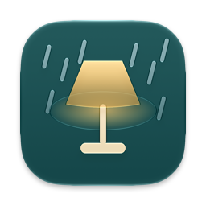
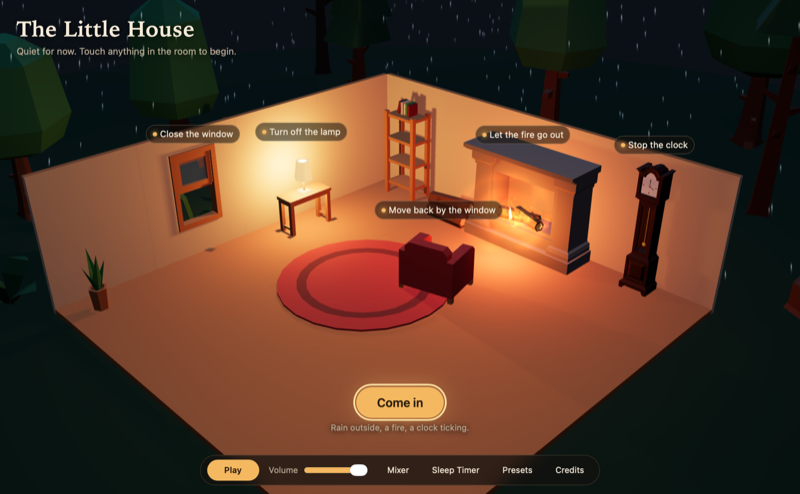

<h1 align="center">The Little House</h1>

A cozy little room on a rainy night, with a fire and a ticking clock to listen to.

<a href="#remix-it-with-lamp">Remix it with Lamp</a>

## Make the room yours

It's yours to change by asking Lamp. A few places to start:

- Make it a starry night sky
- Wake me gently with birdsong
- Make it a rainy Tokyo night

## Remix it with Lamp

[Lamp](https://lamp.dev) is a Mac app that builds apps from a description and changes them as you ask. In Lamp, choose File → Open from GitHub… and paste `https://github.com/lampdotdev/quietroom`: you get this exact wish, yours to change, with the credits below kept.

## Building it

Lamp builds this kind of app: it needs Xcode and signing on your Mac, which Lamp sets up. Open it in Lamp, above.

## Credits

- Based on [moodist](https://github.com/remvze/moodist) by remvze, MIT, at commit `11c0be220011` (license: `Licenses/remvze/moodist/LICENSE`)
- Uses [Rain light 2 (rural)](https://freesound.org/people/jmbphilmes/sounds/200273/) by jmbphilmes, CC0-1.0 (license: `Licenses/sounds/LICENSE-CC0-1.0.txt`)
- Uses [January rain on a window.aif](https://freesound.org/people/mmorgaine/sounds/333510/) by mmorgaine, CC0-1.0 (license: `Licenses/sounds/LICENSE-CC0-1.0.txt`)
- Uses [thunderstorm_5_28_06.wav](https://freesound.org/people/Ionizing/sounds/19283/) by Ionizing, CC0-1.0 (license: `Licenses/sounds/LICENSE-CC0-1.0.txt`)
- Uses [Thunderstorm](https://freesound.org/people/regosss/sounds/238295/) by regosss, CC0-1.0 (license: `Licenses/sounds/LICENSE-CC0-1.0.txt`)
- Uses [Stream River Water Up Close](https://freesound.org/people/jackthemurray/sounds/433589/) by jackthemurray, CC0-1.0 (license: `Licenses/sounds/LICENSE-CC0-1.0.txt`)
- Uses [Gentle Stream Natural Stream Sound](https://freesound.org/people/BurghRecords/sounds/446019/) by BurghRecords, CC0-1.0 (license: `Licenses/sounds/LICENSE-CC0-1.0.txt`)
- Uses [Seawash (calm)](https://freesound.org/people/craiggroshek/sounds/176617/) by craiggroshek, CC0-1.0 (license: `Licenses/sounds/LICENSE-CC0-1.0.txt`)
- Uses [Autumn wind and dry leaves.wav](https://freesound.org/people/Stek59/sounds/457318/) by Stek59, CC0-1.0 (license: `Licenses/sounds/LICENSE-CC0-1.0.txt`)
- Uses [Birds In Spring (Scotland)](https://freesound.org/people/BurghRecords/sounds/463903/) by BurghRecords, CC0-1.0 (license: `Licenses/sounds/LICENSE-CC0-1.0.txt`)
- Uses [Night Crickets Back Porch.aiff](https://freesound.org/people/hdfreema/sounds/333221/) by hdfreema, CC0-1.0 (license: `Licenses/sounds/LICENSE-CC0-1.0.txt`)
- Uses [Cicadas](https://freesound.org/people/dethrok/sounds/272169/) by dethrok, CC0-1.0 (license: `Licenses/sounds/LICENSE-CC0-1.0.txt`)
- Uses [1103campfire1.wav](https://freesound.org/people/moxobna/sounds/62487/) by moxobna, CC0-1.0 (license: `Licenses/sounds/LICENSE-CC0-1.0.txt`)
- Uses [People talking at cafe ambience](https://freesound.org/people/priesjensen/sounds/482990/) by priesjensen, CC0-1.0 (license: `Licenses/sounds/LICENSE-CC0-1.0.txt`)
- Uses [Riding Train interior recording](https://freesound.org/people/gecop/sounds/525058/) by gecop, CC0-1.0 (license: `Licenses/sounds/LICENSE-CC0-1.0.txt`)
- Uses [Electric Fan 01](https://freesound.org/people/unfa/sounds/170870/) by unfa, CC0-1.0 (license: `Licenses/sounds/LICENSE-CC0-1.0.txt`)
- Uses [small clock in room](https://freesound.org/people/Yuval/sounds/211192/) by Yuval, CC0-1.0 (license: `Licenses/sounds/LICENSE-CC0-1.0.txt`)
- Uses [typing](https://freesound.org/people/Rodzuz/sounds/393902/) by Rodzuz, CC0-1.0 (license: `Licenses/sounds/LICENSE-CC0-1.0.txt`)
- Uses [Wind chimes 1](https://freesound.org/people/giddster/sounds/437337/) by giddster, CC0-1.0 (license: `Licenses/sounds/LICENSE-CC0-1.0.txt`)
- Uses [three.js](https://github.com/mrdoob/three.js) by three.js authors, MIT, at commit `fae873455dff` (license: `Licenses/three/LICENSE`)
- Uses [Furniture Kit](https://kenney.nl/assets/furniture-kit) by Kenney, CC0-1.0 (license: `Licenses/kenney/License-furniture-kit.txt`)
- Uses [Nature Kit](https://kenney.nl/assets/nature-kit) by Kenney, CC0-1.0 (license: `Licenses/kenney/License-nature-kit.txt`)
- Uses [Particle Pack](https://kenney.nl/assets/particle-pack) by Kenney, CC0-1.0 (license: `Licenses/kenney/License-particle-pack.txt`)
- Uses [Fireplace](https://poly.pizza/m/nzxZYIOCIr) by Quaternius, CC0-1.0 (license: `Licenses/models/LICENSE-CC0-1.0.txt`)
- Uses [Grandfathers Clock](https://poly.pizza/m/09YKIkFZnA) by CreativeTrio, CC0-1.0 (license: `Licenses/models/LICENSE-CC0-1.0.txt`)

## License

MIT. See [LICENSE](LICENSE).
